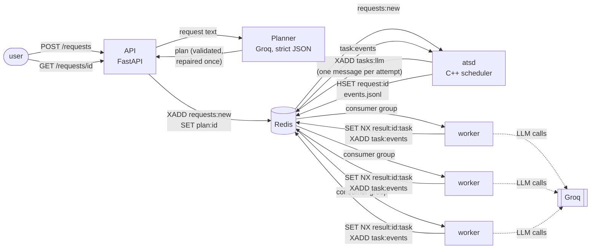
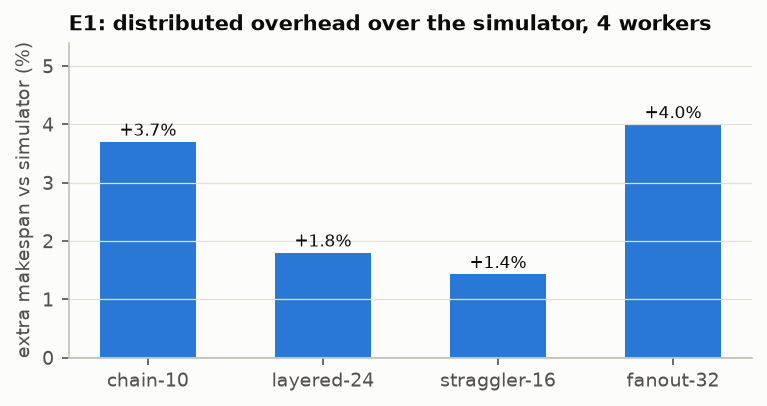
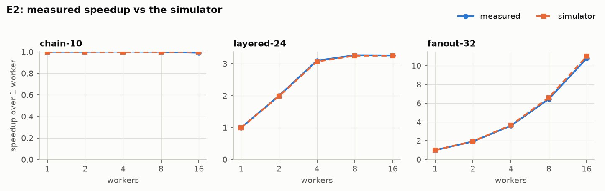
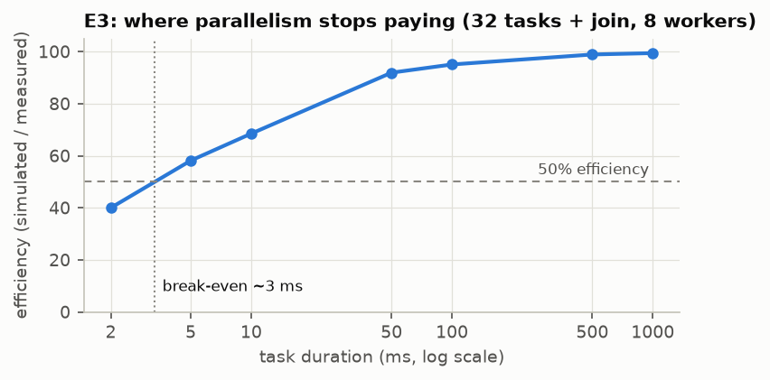
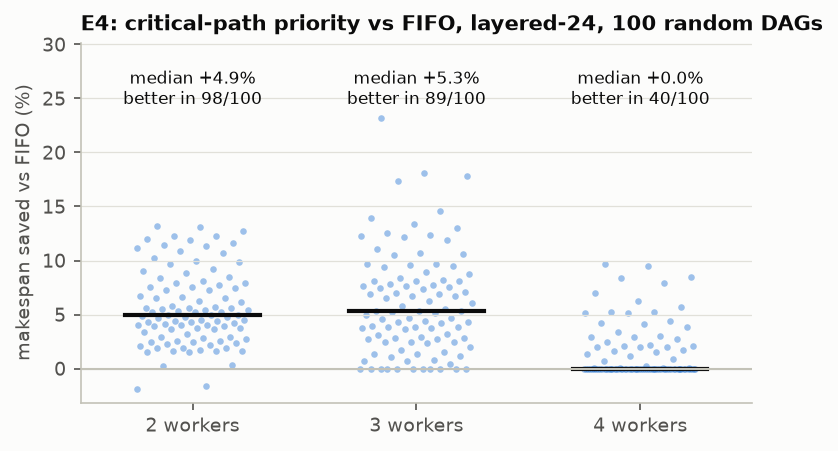
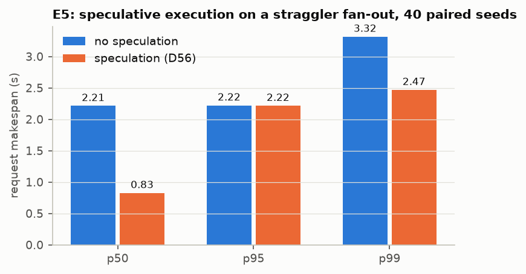
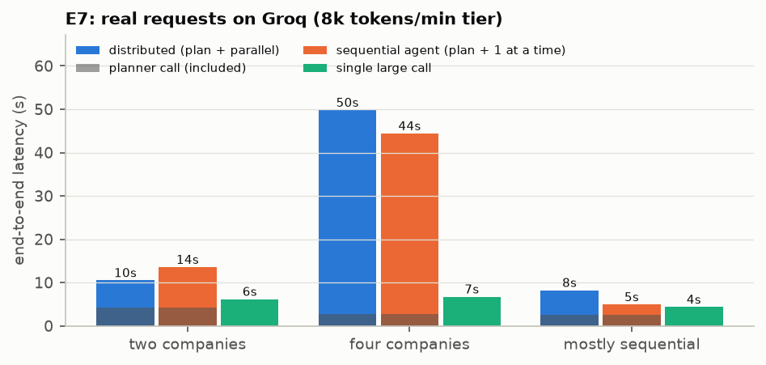
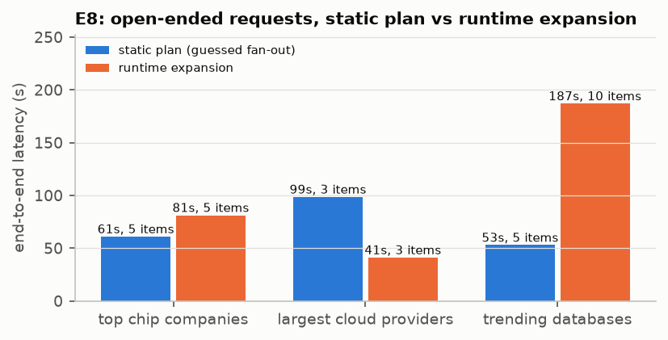

# AI Task Scheduler: report

A typed request ("Research the top 5 AI chip companies and compare them") is turned by an LLM planner
into a validated dependency graph of tasks, which a C++ scheduler runs in parallel on LLM workers over
Redis Streams, retrying failures and growing the graph at runtime when the work is only known once
it starts. This report covers the architecture, the main decisions, the measurements (E1–E8) and the
limitations. Numbers come from `bench/results/` (regenerated by `make bench` and `make bench-dist`;
E7 and E8 by `python -m bench.e7` / `bench.e8` against the running stack).

## 1. Architecture



| Component | Language | Responsibility |
|---|---|---|
| `planner/` | Python | Request → `ExecutionPlan` (Pydantic, the schema source of truth). One Groq call in strict JSON-schema mode, then `validate_plan`; a rejected plan is sent back once with the issues (D8, D54). Also the shared message models (contract #2) and Redis key names. |
| `api/` | Python | `POST /requests` (plan + enqueue), `POST /plans` (hand-written plan), `GET /requests/{id}` (status merged from the plan, atsd's status hash and the committed results), `/report` (Markdown). |
| `scheduler/` (atsd, ats_sim) | C++20 | Loads the plan into a `Dag`, keeps per-request `ExecutionState`, and dispatches ready tasks by policy (FIFO, critical path, fair share across requests) under per-capability in-flight caps. Owns attempts, deadlines, retries with backoff, splicing of expand results, restart recovery and the janitor. `ats_sim` runs the same scheduler on a simulated clock. |
| `worker/` | Python | Consumer group on `tasks:<capability>`; one executor per task type (Groq LLM calls, or a sim executor that sleeps); commits each result once with `SET NX`, then reports the event and acknowledges. |
| `bench/` | Python | Workloads, simulator sweeps, distributed runs, real-LLM experiments, plots. |

Two contracts hold the halves together. **Contract #1** (`docs/contract.md`) is the plan file: the
same 11 fixtures are validated by Python and C++ and must agree (`make parity`). **Contract #2**
(`docs/messages.md`) is the task message, the task events and the result values on Redis.

**One attempt**: atsd writes a task message with an `attempt_id` and a deadline → a worker reads it,
emits `task_started`, loads its dependencies' results, runs the executor, commits the result with
`SET NX` (the first commit wins), emits `task_completed` or `task_failed` (retryable or permanent),
then acknowledges. atsd marks the task done on the first completion, releases its dependents and
dispatches the next ready tasks. An attempt that misses its deadline is declared lost and retried
(D10): there is no other failure detector, which is what makes worker crashes, hangs and lost
messages one case.

**Dynamic expansion** (D50, D53): an `expand` task discovers the items at runtime (step 1: name them;
step 2: one subtask per item, validated, repaired once), and commits a subplan. atsd splices it as
`t2.1 … t2.n` plus a join, rewires the expand task's dependents to the join and gives them every
subtask's result as input. Bounds: 20 tasks per subplan, 3 expansions and 100 tasks per request.

## 2. Key decisions

The full log with rationale is `docs/DECISIONS.md` (D1–D14 in the design doc, D15–D55 during the build).

| Area | Decision |
|---|---|
| Correctness | **Tasks are pure** (D3) and results are committed with `SET NX`: retries, duplicate deliveries and late events can never produce two results, so at-least-once delivery is enough. **Deadlines are the only lost-attempt detector** (D10); heartbeats are for observability. |
| Planning | Strict structured output guarantees the plan's shape, never its meaning, so every plan goes through the validator; **one repair**, then reject (D8). Valid plans with one final task missing or placeholder fan-out after an expand are repaired too, but never rejected (D54). |
| Scheduling | Policies are objects behind `push/pop` (D20); across requests atsd uses fair share by default (D41) and holds a request back only when its next task's capability is full (D42). Optional speculative execution starts one backup for an attempt running past 1.5x its type's p90, using only spare capacity (D56). |
| LLM limits | Groq's on_demand tier allows 8,000 tokens/min: at most 2 LLM calls in flight, 6 attempts (D38); a 429's `retry_after_ms` pauses the whole capability (D39); backoff doubles 2–32 s so a full minute's window can pass (D45). The SDK's own retries are off: retries belong to atsd (8.6). |
| Operations | Clean shutdown drains (D43); unfinished requests resume after an atsd restart from committed results (D44); a janitor acknowledges entries left pending by dead workers (D49); Redis clients reconnect (D40). |
| Results | Results are JSON `{content, key_points}`; over 64 KB they spill to an artifact file (D36); token usage per task is recorded (D37). Research answers come from model knowledge only (D15). |

## 3. Results

Hypotheses from the design doc (section 11), each confirmed or refuted below:

1. Speedup tracks sum / critical path until the in-flight cap. **Confirmed** (E2).
2. The planner call is the single largest fixed cost on real requests. **Confirmed for light requests** (31–52 % of latency); ~5 % when 429 backoff dominates (E7).
3. Critical-path priority helps only when durations are skewed and workers are scarce. **Confirmed** (E4).
4. Tasks shorter than a few milliseconds are not worth distributing. **Confirmed**: break-even ≈ 3 ms (E3).

### E1: does the distributed runtime match the simulator?

Each workload on 4 workers, the real atsd + Redis + sim workers against `ats_sim` on the same plan, at
1/20 time scale (2 s tasks run as 100 ms). The runtime is **1.6–5.8 % slower** than the simulator
(chain-10 +4.1 %, fanout-32 +5.8 %, layered-24 +2.0 %, straggler-16 +1.6 %): the simulator is a
faithful model, so E4 can use it.



### E2: how does it scale?

Speedup over a *measured* 1-worker run (never inferred), against the simulator's:

| workload | 2 workers | 4 | 8 | 16 | bound (sum / critical path) |
|---|---|---|---|---|---|
| chain-10 | 1.00x | 1.00x | 1.00x | 0.99x | 1.00x |
| layered-24 | 2.00x | 3.09x | 3.26x | 3.26x | 3.25x |
| fanout-32 | 1.93x | 3.61x | 6.45x | 10.77x (sim 11.00x) | 16.5x |

Each workload stops where the simulator says it must: a chain never speeds up, layered-24 saturates
at its critical-path bound by 8 workers, and fanout-32 keeps scaling (16 workers run 32 tasks in two
waves, so 11x, not 16x, is the ceiling at that worker count).



### E3: what does each task cost in overhead?

32 independent tasks and a join on 8 workers, task durations 2 ms – 1 s. Overhead is **3–6 ms per
scheduling step** (dispatch → worker → commit → event → atsd → next dispatch through Redis).
Efficiency (simulated / measured makespan) is 42 % at 2 ms, 90 % at 50 ms and 99 % from 0.5 s;
it falls below 50 % for tasks shorter than about **3 ms**. LLM tasks take seconds, so the
scheduler's overhead is negligible for the workload it is built for.



### E4: does critical-path priority beat FIFO?

100 random layered DAGs (6 levels of 4, log-normal durations), simulated:

| workers | median makespan saved | best | better / tie / worse |
|---|---|---|---|
| 2 | +4.9 % | +13.2 % | 98 / 0 / 2 |
| 3 | +5.3 % | +23.2 % | 89 / 11 / 0 |
| 4 (= graph width) | +0.0 % | +9.6 % | 40 / 60 / 0 |

Critical-path priority pays off when workers are scarce relative to the graph's width, and mostly
ties once there is a worker for every ready task. It is a heuristic: in 2 of 100 cases it was
slightly worse (−1.9 %). On straggler-16 (one 10x task) it starts the long task first and cuts the
4-worker makespan from 28 s to 22 s.



### E5: does speculation cut tail latency?

16 tasks of 2 s and a join on 16 workers, the real atsd, Redis and sim workers at 1/10 time scale
(`bench/e5.py`, `make bench-e5`). Every attempt straggles (runs 10x longer) with probability 10 %,
decided per attempt id, so each seed runs twice, without and with speculation (D56), with the
same primary attempts straggling; a backup is a new attempt id and gets a fresh draw. 40 seeds:

| mode | p50 | p95 | p99 | max | backups (won) |
|---|---|---|---|---|---|
| no speculation | 2.21 s | 2.22 s | 3.32 s | 4.02 s | – |
| speculation | **0.83 s** | 2.22 s | **2.47 s** | 2.63 s | 82 (68) |

Speculation cuts the **median makespan by 63 %** and the p99 by 26 %, for a median of **+6 %
extra worker time** (paired by seed; p95 +32 %). It does **not** move the p95, for a reason the
runs show directly: a backup straggles too in 10 % of cases, and atsd starts at most one backup
per task, so the ~30 % of runs where some backup was also slow stay at the straggler's 2.2 s
(12 of 40). The single join task never got a backup (seed 6): the p90 is per task type and needs 5
completed samples, and the join is the only `report` task. Losing attempts run to completion
(there is no cancel), which is where the extra worker time goes. With 40 runs per mode the p99 is
close to the maximum: indicative, not tight.



**Latency profile** (all E5 runs, 1,442 attempts; one host, so worker and atsd clocks agree):

| step | p50 | p95 | p99 |
|---|---|---|---|
| pickup: atsd dispatches → worker reports `task_started` | 1 ms | 2 ms | 3 ms |
| report: worker reports `task_completed` → atsd records it | 1 ms | 2 ms | 3 ms |
| handoff: last parent completes → child dispatched | 2 ms | 3 ms | 3.2 ms |

Each Redis hop plus atsd's loop costs about a millisecond; a full scheduling step between two
dependent tasks is 2–3 ms, consistent with E3's 3–6 ms per step (which also includes the worker
writing and reading results).

### E6: is it fault tolerant?

Sim stack with 20 % injected errors, 5 % simulated 429s, 5 % hangs, stragglers and crashes, while
`scripts/chaos.py` kills worker containers mid-task (`make chaos`): 6 requests, 3 workers killed,
20 retries and 4 lost attempts recovered at their deadline, **all requests succeeded, 0 duplicate
commits**. The in-process chaos test (`worker/tests/test_chaos.py`, real atsd) passed 5 runs out of 5.
On real Groq tasks (the Day 5 gate), the worker running t4 was killed: atsd declared the attempt
lost at its deadline, retried it on another worker, and the request succeeded in 75 s with no
duplicate commit.

### E7: what does it buy on real requests?

Three eval requests on Groq (`openai/gpt-oss-120b`, 8,000 tokens/min tier), each planned once and
then run three ways (D55): **distributed** (the plan on the stack: atsd, 3 workers, at most 2 LLM
calls in flight), **sequential** (the same plan, same executors, one task at a time: an agent doing
the steps one by one) and **single** (one large call answering the whole request).

| request | mode | latency | planner share | LLM calls | tokens in / out | cost | 429 retries |
|---|---|---|---|---|---|---|---|
| two_companies (6 tasks) | distributed | **10.5 s** | 41 % | 7 | 5,492 / 4,306 | $0.0034 | 0 |
| | sequential | 13.6 s | 32 % | 7 | 5,490 / 4,279 | $0.0034 | 0 |
| | single | 6.2 s | – | 1 | 140 / 2,823 | $0.0017 | 0 |
| four_companies (6 tasks) | distributed | 49.8 s | 5 % | 7 | 7,553 / 6,877 | $0.0053 | 2 |
| | sequential | 44.4 s | 6 % | 10 | 7,945 / 7,189 | $0.0055 | 3 |
| | single | 6.7 s | – | 1 | 141 / 3,072 | $0.0019 | 0 |
| mostly_sequential (3 tasks) | distributed | 8.2 s | 31 % | 4 | 2,740 / 2,861 | $0.0021 | 0 |
| | sequential | 4.9 s | 52 % | 4 | 2,308 / 1,216 | $0.0011 | 0 |
| | single | 4.3 s | – | 1 | 143 / 1,882 | $0.0012 | 0 |



Reading it honestly:

- **On this provider tier, one large call is the fastest and cheapest way to an answer** (4–7 s,
  about half the cost). Every plan-based mode pays for a planner call plus one call per task, and each
  task re-reads its dependencies' results, so it spends roughly twice the tokens. The single answer is
  also the longest (6–12k characters against 2–4k for the final report task, which summarizes).
- **Parallelism helps when the rate limit allows it**: on two_companies the two research branches ran
  together and the distributed run beat the sequential agent by 23 % (10.5 s vs 13.6 s). On
  four_companies, four research tasks in parallel used up the minute's 8,000 tokens and the report task
  waited out 429 backoff (D39, D45): both plan-based modes took 44–50 s, dominated by the provider limit,
  not by scheduling. mostly_sequential has no parallel branch, so there was nothing to gain, and the 3 s
  difference is the variance of one LLM call (the sequential run's final answer was a third as long).
- **Hypothesis 2 (the planner is the largest fixed cost): confirmed for light requests.** The planner
  call (2.6–4.3 s) is longer than any single task and is 31–52 % of end-to-end latency when no rate
  limiting occurs; it is only ~5 % when 429 waits dominate.
- What the plan buys is not speed on this tier but **structure**: per-entity tasks that can be retried
  independently (a failed or rate-limited task is retried, not the whole answer), inspectable
  intermediate results, token accounting per task, and requests whose items are only known at runtime
  (E8). With a provider tier that allows 8+ calls in flight, E2's scaling applies to the task phase.
- Each mode ran once per request, so the numbers are indicative; LLM latency varies by ±30 % between
  identical calls.

### E8: does dynamic expansion beat planning once?

The 3 open-ended eval requests (the items are not in the request), each planned two ways (D55):
**expand** (the normal planner: an expand task discovers the items at runtime and atsd splices one
task per item) and **static** (the planner told never to use expand, so it guesses the items at
planning time). Both run on the same stack.

| request | mode | latency | items (requested) | expand task tokens | splice delay | tokens in / out | cost | 429 retries |
|---|---|---|---|---|---|---|---|---|
| top 5 AI chip companies | static | **61 s** | 5 (5) | – | – | 7,669 / 7,087 | $0.0054 | 5 |
| | expand | 81 s | 5 (5) | 4,692 | 1 ms | 12,616 / 7,636 | $0.0065 | 5 |
| three largest cloud providers | static | 99 s | 3 (3) | – | – | 4,501 / 3,632 | $0.0029 | 5 |
| | expand | **41 s** | 3 (3) | 1,758 | 1 ms | 7,483 / 5,651 | $0.0045 | 3 |
| open-source vector databases (no count) | static | **53 s** | 5 (–) | – | – | 8,627 / 6,218 | $0.0050 | 4 |
| | expand | 187 s | 10 (–) | 2,646 | 1 ms | 20,803 / 11,769 | $0.0102 | 16 |



Reading it:

- **The splice itself is free**: 1 ms from the expand task's commit to the first spliced task's
  dispatch in every run. Expansion makes no extra *planner* calls. Its cost is the expand task's own two
  model calls (discovery, then the subplan; D50): 1.8–4.7k tokens, under a quarter of the request's total.
- **When the request names a count, both modes cover it exactly** (5 of 5, 3 of 3). Expansion is not
  needed for coverage there; the model already knows the items. Latency went either way (81 s vs 61 s,
  41 s vs 99 s) and is dominated by 429 backoff, not by the plan's shape.
- **When the request gives no count, expansion covers more**: 10 vector databases against 5 guessed at
  planning time. Ten parallel research tasks on an 8k tokens/min tier then spent most of their time in
  429 backoff (16 retries, 187 s). More coverage cost 2x the tokens and 3.5x the latency. A bound on the
  fan-out (the subplan allows up to 20) or a provider tier with more throughput is the lever here.
- **Static plans try to discover anyway, incoherently.** Told not to use expand, the planner added an
  "Identify the three largest cloud providers" task in 2 of 3 plans, and made its guessed per-item tasks
  ("Summarize AWS AI strategy") wait for it. That discovery cannot change which items get researched: if
  it finds a different list, the plan cannot follow. It is also why static cloud providers was slower
  (a serial discovery step plus 429s). Expansion is the coherent version of the same idea: discovery
  decides the fan-out.
- The run also found a quality issue, fixed afterwards: in two of three expand runs the subtask titles
  were whole sentences ("NVIDIA leads with projected $30 B…") instead of names. Coverage was unaffected
  (each still named one item). Cause: the discovery step's prompt ended with the shared output format
  ("key_points: … one short sentence each"), which overrode its own "names only" rule; expand now has
  its own output section (`worker/prompts/output_expand.md`), with a regression test. Not yet re-run
  live (see limitations).
- One run per mode: indicative, not statistically tight.

### E9: is the workflow's answer as good as one normal LLM call?

E7 and E8 measure speed and cost; their only measure of the answers is length. E9 measures
correctness, on public datasets with reference answers (`bench/datasets/`, sources and licenses in its
README), using the questions and scoring rule of LLMCompiler (Kim et al., ICML 2024), the closest prior
work:

| dataset | questions | what it needs |
|---|---|---|
| ParallelQA | 113 | facts about 2–5 entities, then arithmetic ("If the Mariana Trench were 20 % shallower …") |
| HotpotQA comparison | 200 of 1,487 | two entities, then a comparison ("Which writer was from England, …?") |
| Movie recommendation | 100 of 500 | four movies, then one of four options |

Each question runs as the **workflow** (planner → plan → atsd and the LLM workers) and as a **single
call**, on the same model with the same answer-format instruction. Correct means a numeric reference
matched within 10 %, otherwise an exact match after normalisation; token-F1 is reported alongside.
Results are broken down by the number of entities, where parallel lookups should matter most
(`bench/e9.py`, `make bench-e9`, D57).

**Results: not run yet.** `make up-llm && make bench-e9` writes the table and `e9_accuracy.png` to
`bench/results/`. On Groq's free tier about 30 questions × 2 modes fit in one day's token budget; the run
stops at the budget and continues on the next day. LLMCompiler's agents used a search tool; here both
modes answer from model knowledge (D15), so the scores compare this project's two modes with each other,
not with the paper's results.

## 4. Limitations

- **Rate limits dominate real latency.** Groq's on_demand tier for gpt-oss-120b allows 8,000 tokens per
  minute and **200,000 tokens per day**; E7 + E8 + the gate runs used the day's budget, after which
  Groq asked for a ~20 min wait and atsd paused the capability for exactly that long (D39). On the 8,000 tokens/min tier at most 2 LLM calls run at
  once, and 429 backoff adds seconds to tens of seconds; the parallel speedup the scheduler can deliver
  (E2) is capped by the provider, not the runtime. A paid tier changes two settings (`LLM_INFLIGHT`,
  `LLM_ATTEMPTS`).
- **Answers come from model knowledge** (D15): no web search, so "top companies by 2025 revenue" is
  the model's training-time view, not current data. Report outputs say so.
- **On this provider tier the plan does not buy speed** (E7): one large call answers in 4–7 s and
  costs half as much. The plan buys per-task retries, inspectable intermediate results and runtime
  discovery (E8); its parallel speedup (E2) needs a tier with more calls in flight.
- **Expansion has no cost-aware bound beyond 20 subtasks**: an unbounded request ("the most widely used
  vector databases") expanded to 10 tasks and spent most of its time in 429 backoff (E8).
- **Planner quality is checked structurally, not semantically.** The eval asserts graph shape (width,
  single sink, expand usage); it does not grade the answer. A live gate run found a placeholder task
  the eval had not caught (fixed by D54); prompt rules alone are not reliable.
- **The API returns 502 when the planner is rate-limited**, instead of queueing the request or
  returning 503 with a retry-after.
- **Benchmarks use in-process sim workers** (D51): overhead includes Python event-loop scheduling, so
  E1/E3 overhead is an upper bound for separate worker processes. E4 runs in the simulator only.
- **A subplan stored as an artifact (> 64 KB) cannot be spliced**, because atsd has no artifacts volume;
  20 tasks of this schema stay far below that.
- **Speculation starts at most one backup per task** and never cancels the loser (E5): it cuts the
  median, not the p95, when backups can straggle too; a task type with fewer than 5 completed
  attempts (a single join) never gets a backup.
- **Not implemented**: the dashboard (stretch goal); one Redis
  instance (no Redis HA); one atsd per Redis (no scheduler failover beyond restart recovery).

## 5. How to reproduce

```bash
make build && make test          # C++ + Python unit, parity, integration (incl. atsd end to end)
make bench                       # simulator sweep + E4 -> bench/results/*.png, summary.md
make bench-dist                  # + E1–E3 with the real atsd and Redis (~1 min)
make bench-e5                    # E5 + latency profile with the real atsd and Redis (~3.5 min)
make bench-e9 N=10               # E9 on the running LLM stack (make up-llm), within the day's Groq budget
make chaos                       # E6 on the Docker stack
make up-llm                      # real Groq stack (GROQ_API_KEY in .env)
cd bench && uv run --env-file ../.env python -m bench.e7   # E7 (~15 min, rate-limited)
cd bench && uv run --env-file ../.env python -m bench.e8   # E8
```
